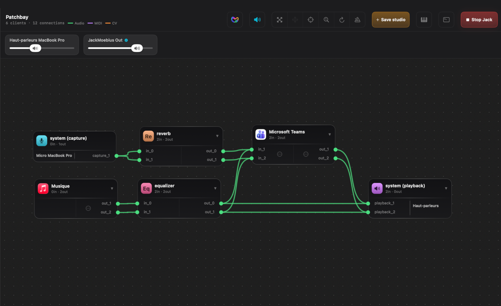

## The problem

Most macOS apps speak **CoreAudio**, not **JACK**. And ever since macOS Catalina removed
the old `AudioHardwarePlugIn` API in October 2019 (the change that broke the original
*JackRouter* and left it abandoned on modern macOS), there has been **no supported way**
to take Safari's playback, a video call's microphone, or a DAW's helper process and route
it through a JACK graph. CoreAudio apps and JACK have lived in separate worlds.

**JackMoebius changes that**: it bridges the two, **per application** and **in both
directions**, without touching the app itself.

## The pieces

JackMoebius is two components (plus a CLI):

- **The driver**: an [`AudioServerPlugIn`](https://developer.apple.com/documentation/coreaudio/creating_an_audio_server_driver_plug-in)
  virtual audio device (`JackMoebius`), plus a device of its own for an app when you ask for one. It runs
  inside `coreaudiod`, in **userspace**: no kernel extension, no SIP changes. It presents the routing endpoints
  that apps and the daemon attach to.
- **The daemon**: `jackmoebiusd`, a Swift process that exchanges audio with the driver through shared memory,
  registers per-app clients in JACK, and keeps everything in sync. It runs **only while
  a JACK server is up** and self-stops when JACK goes away.
- **The CLI**: `jackmoebius`, a control tool that talks to the daemon over a local
  socket (the same [IPC protocol](ipc.qmd) a GUI like [JackMate](https://jackmate.app) uses).

## The forward path: an app's output into JACK

When you **expose** an app:

1. The app's CoreAudio output is routed onto the JackMoebius device, or onto a device of its own (see
   [below](#shared-or-a-card-of-its-own)).
2. The daemon reads it and publishes a **JACK client box** for that app, with output
   ports on reserved channels.
3. Anything in your JACK graph can now read the app's audio: patch it into a recorder,
   an effect, a DAW, another app.

The channel reservation is **persistent**: an app that stops and restarts audio comes
back on the *same* channels, so a saved patchbay restores itself.

## Volume: two gain stages that stack

Loudness in a JackMoebius chain runs through **two independent gain stages**, and they
**multiply**:

1. **JackMoebius**: each exposed app plays into the JackMoebius device, which
   carries its own CoreAudio volume.
2. **The output JACK feeds**: `system:playback` drives your real output device (interface
   or speakers), which has its own volume too.

Turn either one down and the app gets quieter, which is easy to mistake for a routing problem.
That's why [JackMate](https://jackmate.app) puts these volumes on screen: a
slider for the output JACK feeds **plus a per-app slider** for every exposed app, so you
balance both stages finely and fast, in one place, with no trip to System Settings or Audio
MIDI Setup.

## The reverse path: JACK into an app's input

The bridge is **bidirectional**. Exposing an app's **input** makes JACK audio its microphone: either through
the **shared input** (the ports `shared_input_1/2`, which every app in that mode reads) or through a device of its
own, **JackMoebius for <App>**, fed by JACK. The app selects it as its microphone, and now **JACK audio becomes the
app's input**: process a live instrument through your JACK effects and send the result straight into a video call.

## Shared or a card of its own {#shared-or-a-card-of-its-own}

Each direction of an app, input and output, goes one of two ways:

| | Shared | A card of its own |
|---|---|---|
| **Device** | the common **JackMoebius** device | **JackMoebius for <App>** |
| **Output** | a stereo pair of its own for the app, separate from every other app | 1 to 64 channels |
| **Input** | the same two channels for every app in this mode | 1 to 64 channels of its own |
| **In the app** | nothing to set: it follows the Mac's default output and input | you select the card as its device |

If an app has no device menu (browsers, dictation, many small apps), use the shared device. If it lets you choose
its input or output, a card gives it channels of its own. If an app has a single device setting for both directions and you
want it on a card, make both directions cards (or leave both shared and select JackMoebius). The [CLI reference](cli.qmd#apps-routing) shows how to choose, and
[JackMate](jackmate.qmd) does it with a menu per app.

## Event-driven, no polling

The daemon watches CoreAudio (apps launching/quitting, starting/stopping audio,
switching devices) and JACK, and reconciles the graph as things change. It exposes a
persistent **subscribe** channel over the IPC socket that pushes *invalidations* when
something moves, so a front-end stays in sync **without polling**, and knows instantly
if the daemon stops (the connection closes).

## Lifecycle

**Daemon running ⟺ JACK up.** Start a JACK server (via [JackMate](https://jackmate.app)), activate JackMoebius,
and the devices appear in the system selectors; stop JACK and they vanish. The daemon
is normally launched through a per-user **LaunchAgent** (which [JackMate](https://jackmate.app) kick-starts),
so it runs in the right session with its own identity.

**One account at a time.** JackMoebius serves a single account on a Mac: the audio devices belong to the whole
system and the transport between the driver and the daemon has one place. If another account is already using
JackMoebius, `jackmoebius status` and `jackmoebius doctor` tell you which one. Before leaving a shared Mac, quit
JACK (or log out), so the next person can use JackMoebius.

→ Next: the [IPC protocol](ipc.qmd) and the [CLI reference](cli.qmd).
